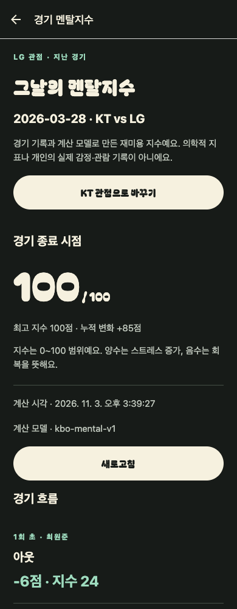
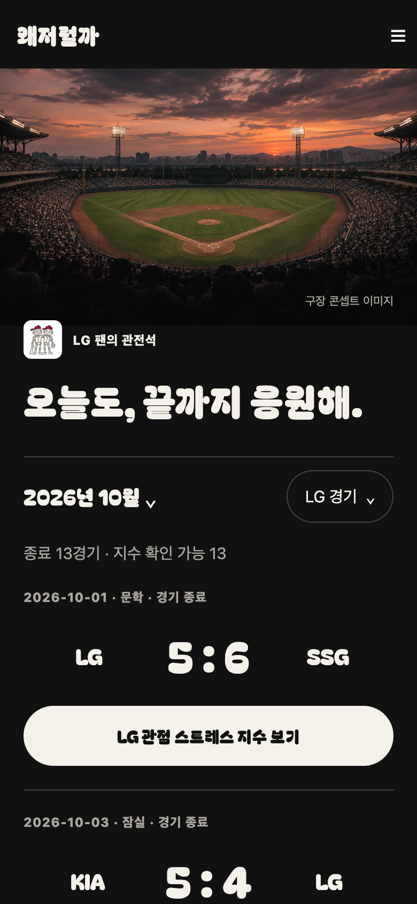
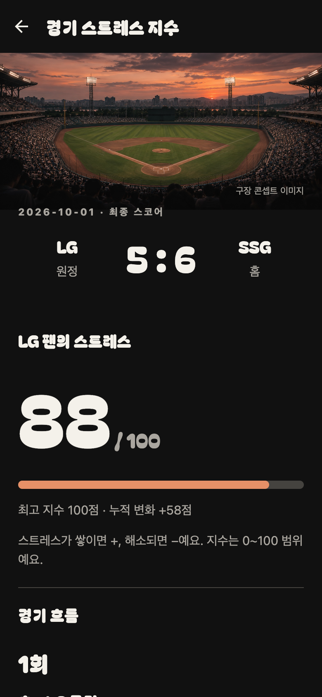

# 왜저럴까

야구 경기의 순간들을 팬의 스트레스 지수로 기록하는 앱입니다.
실책·병살·호수비·적시타 등의 이벤트와 이닝·아웃·주자·점수 차를 반영해 경기 중 멘탈 변화를 보여줍니다.

첫 실행 응원팀 선택, 샘플 경기 체험과 **2026 지난 경기 멘탈지수 조회**를 제공합니다. 지난 경기 API는 Render·Atlas 무료 운영 환경에 연결했습니다. 지수는 재미를 위한 지표입니다. [처리 범위와 계산 기준](docs/season-mental.md)을 참고하세요.

**스토어 배포 준비는 아직 완료되지 않았습니다.** [배포 준비 현황](docs/release-readiness.md), [실기기 내부 테스트](docs/internal-device-testing.md)와 [시뮬레이터 테스트 안내](docs/simulator-testing.md)를 참고하세요.

## 구현 기능

- 첫 실행 응원팀 선택·기기 저장, 설정에서 전체 화면으로 팀 변경
- 홈에 응원팀의 최근 종료 경기 월 표시, 모달에서 팀·연월 선택
- 2026 지난 경기 목록·팀별 멘탈지수와 사건 타임라인
- 검증 미완료·미수집 경기 구분, 관전 기록 없이 공통 결과 조회
- 샘플 경기 목록과 경기 상세 화면
- 경기 상황에 가중치를 적용한 스트레스 지수와 이벤트별 변화 표시
- 샘플 이벤트 순차 재생 및 초기화
- 결과 텍스트 공유
- 로컬 알림 예약, Expo 푸시 토큰 발급, 알림 탭 시 경기 화면 이동

모바일과 서버를 함께 관리하는 모노레포입니다. 서버에는 FastAPI·MongoDB 연결, 과거 경기 검증용 저장·조회 API가 있습니다. 운영 API는 배포했으며 실시간 이벤트 정규화, 회원 인증, 개인 관전 기록·선수별 시즌 통계·개인화 푸시는 아직 미완료입니다. 응원팀은 현재 기기에만 저장합니다.

서버 구성, AWS 비용 비교와 과거 경기 3건의 데이터 접근 검증 결과는 [서버 계획](docs/backend-plan.md)에 정리했습니다. 과거 응답 조회 성공과 실시간 수집 검증은 구분합니다.

### 실제 과거 경기 조회 화면



2026-03-28 KT-LG 경기의 로컬 DB 결과를 보여주는 모바일 크기 웹 캡처입니다. 네이티브 앱·스토어 제출 스크린샷은 아닙니다.

## 디자인 방향과 시안

**고정 차콜·아이보리 테마 + 구장 이미지 + Bagel Fat One 타이포그래피**를 적용했습니다.

- 응원팀을 변경해도 앱 배경·버튼·모달 색상 유지
- 둥근 제목·큰 스코어, 아이보리 알약형 버튼, 얇은 구분선
- 스트레스 증가는 주황, 회복은 민트로 표시
- 팀 선택은 경기 조회 관점과 낙서풍 캐릭터에 반영
- 구장 이미지는 공통 생성형 콘셉트이며 실제 경기장 사진이 아님

| 시즌 경기 | 경기 상세 |
|---|---|
|  |  |

위 이미지는 로컬 검증 프록시로 실제 경기 API에 연결한 모바일 크기 웹 캡처입니다. 네이티브·스토어 제출 스크린샷은 아닙니다. [디자인 명세](docs/design.md)에서 승인 시안과 현재 구현 범위를 확인할 수 있습니다.

<details>
<summary>이전 프로토타입 구현 화면 — 종이색·그린 테마</summary>

아래는 구버전 앱 코드의 모바일 크기 웹 캡처입니다. 최신 디자인이나 네이티브·스토어 제출 이미지가 아닙니다.

| 경기 목록 | 경기 상세 | 알림 |
|---|---|---|
|  |  |  |

</details>

## 기술 스택

| 구분 | 기술 |
|---|---|
| 앱 | React Native 0.88, Expo SDK 58 |
| 언어 | TypeScript / Python 3.13 |
| 서버 | FastAPI · Beanie · MongoDB |
| 의존성 | npm workspaces / uv lock |
| API 계약 | FastAPI에서 생성한 OpenAPI |
| 화면 이동 | Expo Router |
| 알림 | expo-notifications |
| 빌드 | EAS Build |
| 검증 | TypeScript, ESLint, Node.js Test Runner, GitHub Actions |

## 로컬 실행

Node.js 22.23 이상을 권장합니다.

```sh
npm ci
npm run web       # 웹에서 화면 확인
npm start         # 개발 빌드용 Metro 실행
```

알림은 전용 개발 빌드 또는 preview 빌드에서 확인합니다. 웹 미리보기에서는 지원하지 않습니다.

## 프로젝트 구조

```text
apps/
  mobile/              # React Native + Expo, EAS 설정과 모바일 테스트
  server/              # Python + FastAPI, 독립 의존성·Dockerfile
    app/               # 조회 API, DB 모델과 저장소
    workers/           # 수동 과거 경기 검증·저장
    tests/             # API·수집·MongoDB 통합 검증
contracts/             # 생성된 OpenAPI 명세
infra/                 # 로컬 API·MongoDB Compose
docs/                 # 기획·디자인·기술 검증
.github/workflows/     # 모바일·서버 독립 검증 작업
```

[서버 실행 방법](apps/server/README.md) · [API 계약](contracts/README.md) · [인프라 구성](infra/README.md)

서버는 `apps/server`에서 `uv sync --locked` 후 실행합니다. Docker가 있다면 루트에서 `docker compose -f infra/compose.yaml up --build`로 로컬 API와 DB를 함께 실행할 수 있습니다.

## 빌드 설정

```sh
cd apps/mobile
npx eas-cli@latest login
npx eas-cli@latest project:info
```

기존 EAS 프로젝트 연결은 `apps/mobile/app.json`에 유지합니다. 저장소 이름과 Expo slug는 독립적이므로 Expo slug는 그대로 둡니다. 모든 EAS 명령은 `apps/mobile`에서 실행합니다. 앱 표시 이름은 `왜저럴까`, 양 플랫폼 식별자는 `com.kimbaebae.baseballmental`입니다.

| 프로필 | 용도 |
|---|---|
| `development` | 개발 클라이언트, Metro 연결 |
| `simulator` | iOS 시뮬레이터용 개발 클라이언트 |
| `preview` | Metro 없이 실행하는 내부 배포 빌드; Android는 APK |
| `desktop-preview` | Metro 없이 실행하는 iOS 시뮬레이터 앱과 Android APK |

```sh
npx eas-cli@latest build --platform android --profile preview
npx eas-cli@latest build --platform ios --profile preview
```

Android는 빌드 완료 후 APK 링크로 설치합니다. iOS 내부 배포에는 Apple 서명 설정과 테스트 기기 등록이 필요합니다.

## 알림 설정

- **Android:** Firebase 앱의 패키지명을 앱 설정과 일치시키고, FCM v1 자격 증명을 EAS에 등록합니다.
- **iOS:** Apple Developer 서명과 APNs 자격 증명을 설정합니다.
- **Firebase 설정 파일:** `GOOGLE_SERVICES_JSON` 환경 변수에 파일 경로를 지정합니다. EAS에서는 파일 환경 변수를 사용할 수 있습니다.

앱의 알림 테스트 화면에서 로컬 알림과 원격 푸시 토큰 발급을 각각 확인할 수 있습니다.
원격 발송 스크립트는 다음 환경 변수를 사용합니다.

| 변수 | 용도 |
|---|---|
| `EXPO_PUSH_TOKEN` | 테스트 대상 기기의 Expo 푸시 토큰 |
| `EXPO_ACCESS_TOKEN` | Expo push security 사용 시 인증 토큰 |
| `EXPO_RECEIPT_ID` | 지정하면 발송 대신 해당 영수증 조회 |

```sh
npm run push:test
```

스크립트는 셸 환경 변수를 읽으며 `.env`를 자동으로 로드하지 않습니다.
발송 요청 접수와 기기 수신은 별도로 확인해야 합니다. 전경·배경·종료 상태에서 수신과 경기 화면 이동을 검증합니다.

## 환경 변수와 자격 증명

`.env*`, 인증서, 서명키, Firebase 설정 파일, `credentials.json`은 Git에서 제외합니다.
서버 키와 서비스 계정 자격 증명은 서버 환경 또는 EAS 자격 증명으로 관리합니다.
`EXPO_PUBLIC_*`와 앱 번들에 삽입되는 설정값에는 비밀값을 넣지 않습니다.

## 검증

```sh
npm run typecheck
npm run lint
npm test
npm run export
```

루트 npm 명령은 모바일 workspace에 위임합니다. GitHub Actions는 모바일 검사와 별도로 서버 lint·테스트·실제 MongoDB 통합 검증·스키마 동기화·컨테이너 빌드를 실행합니다. 테스트는 상황별 가중치, 중복 이벤트 처리, 기록 정정, 지수 범위 제한을 다룹니다.

현재 로컬에서 타입 검사·lint·도메인 테스트와 iOS·Android·웹 번들 생성을 확인했습니다.
이전 구조의 Android 내부 배포 빌드는 성공했습니다. 모노레포 전환 후 네이티브 클라우드 빌드·실기기 실행·원격 푸시 수신은 별도 검증이 필요합니다.

### 알려진 이슈

2026-10-26 기준 Expo CLI의 node-forge/Zod 의존성 경로에 npm audit high 경고 5건이 있습니다.
배포 전 SDK 호환 업데이트를 검토해야 합니다.

## 참고

- [Expo 푸시 알림 설정](https://docs.expo.dev/push-notifications/push-notifications-setup/)
- [EAS 내부 배포](https://docs.expo.dev/build/internal-distribution/)

## UI 자동화 테스트

Appium + WebdriverIO + TypeScript로 iOS·Android에서 공통 샘플 경기 흐름을 검증합니다. 설치, 실행 명령, 결과 확인은 [UI 테스트 가이드](docs/ui-testing.md)를 참고하세요.

CI/CD 설정 점검과 플랫폼별 배포 준비 작업은 [출시 작업 명세](docs/cicd-release-plan.md)를 참고하세요.

[출시 준비 실행 순서](docs/execution-order.md) · [배포 자동화](docs/release-automation.md) · [서버 배포 검사](docs/server-deployment.md) · [모바일 API 연결](docs/mobile-api.md)

[AWS 비용 비교와 호스팅 선택](docs/aws-cost-comparison.md)

내부 테스트 설치 링크와 자동 갱신 정책은 [내부 테스트 안내](docs/internal-testing.md)를 참고하세요.
