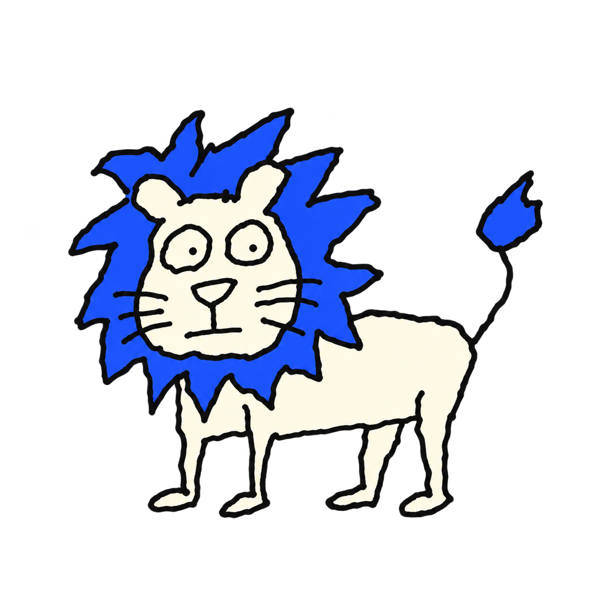
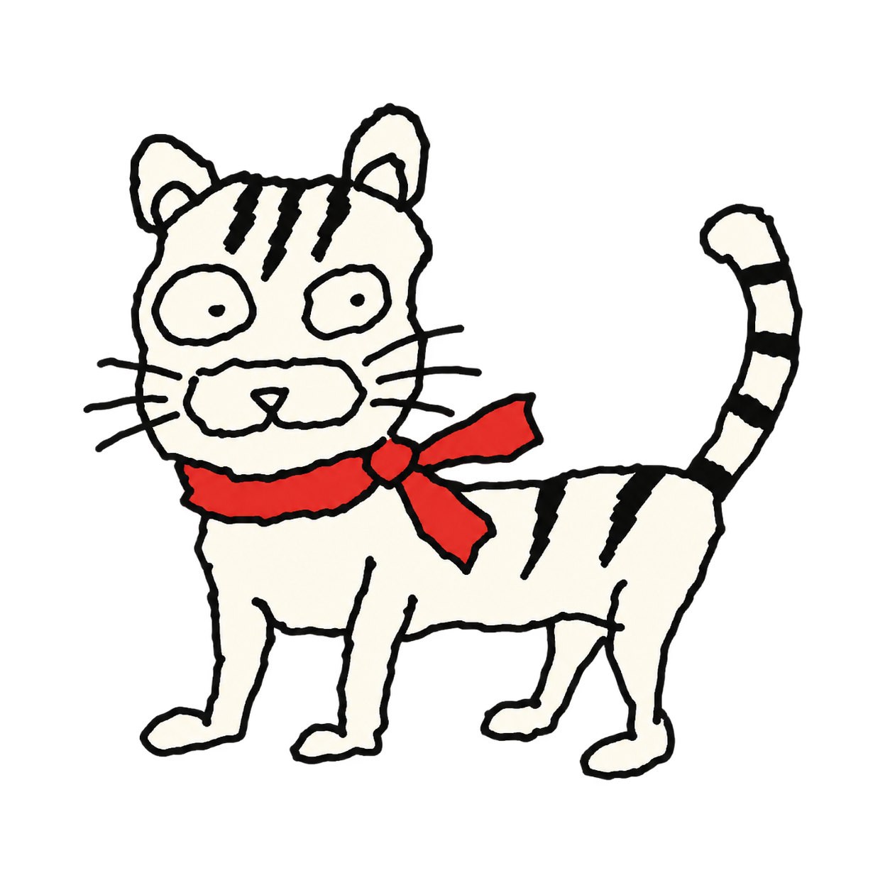
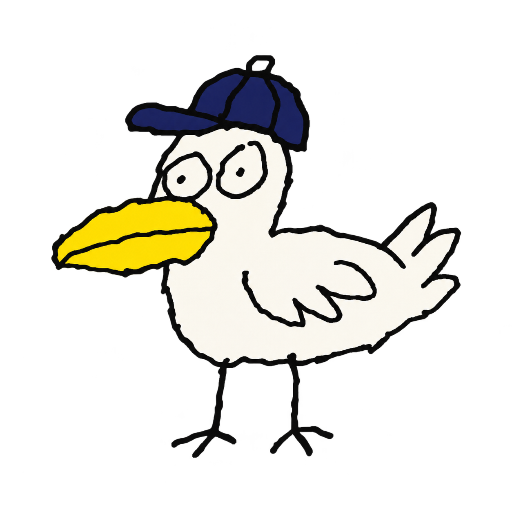
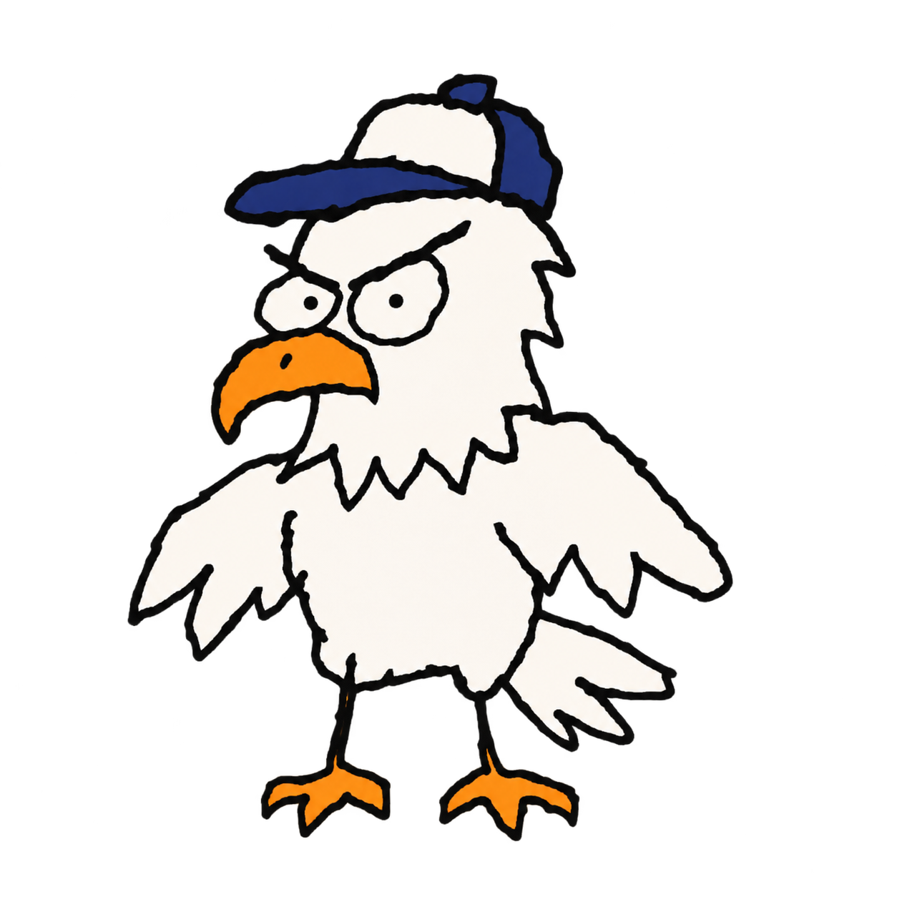
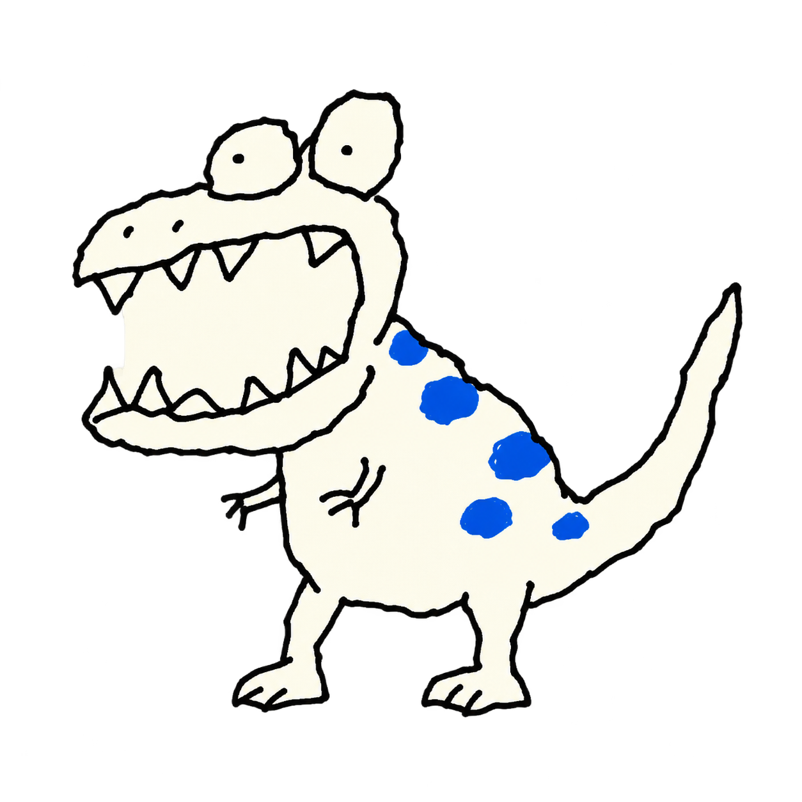
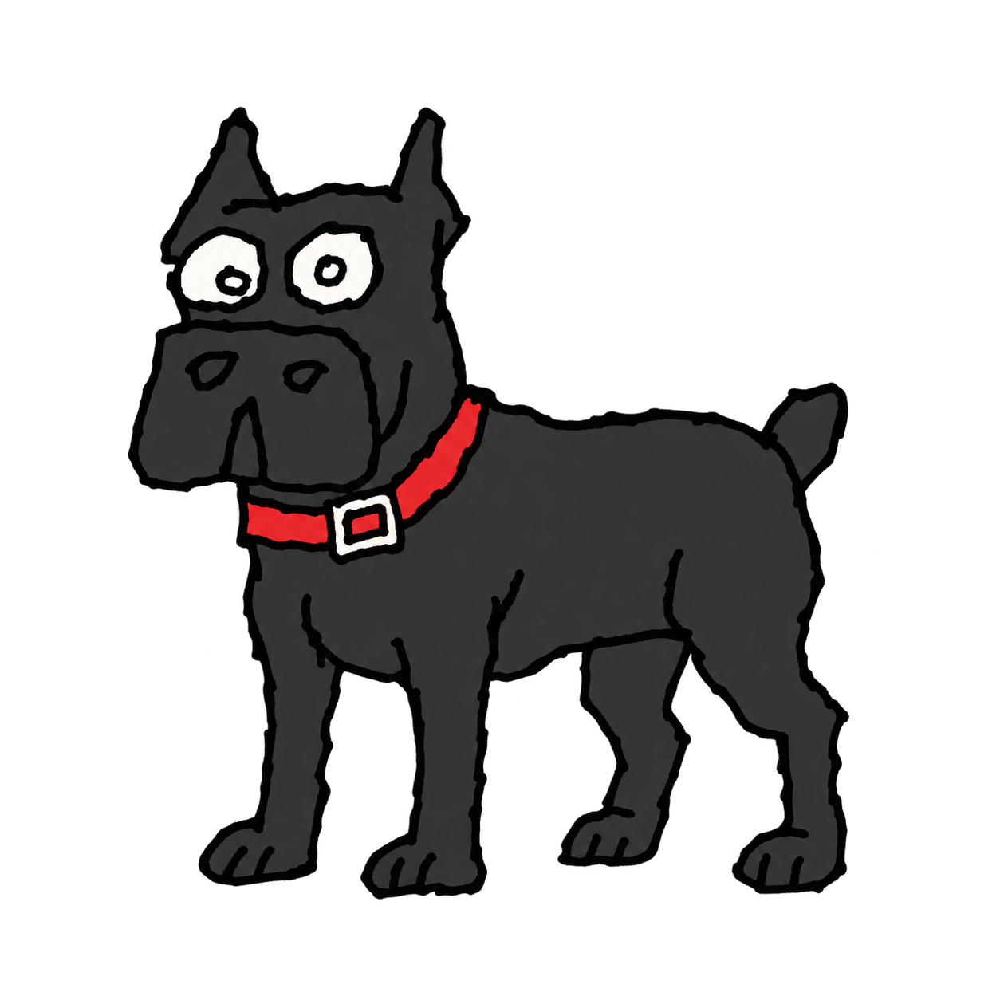
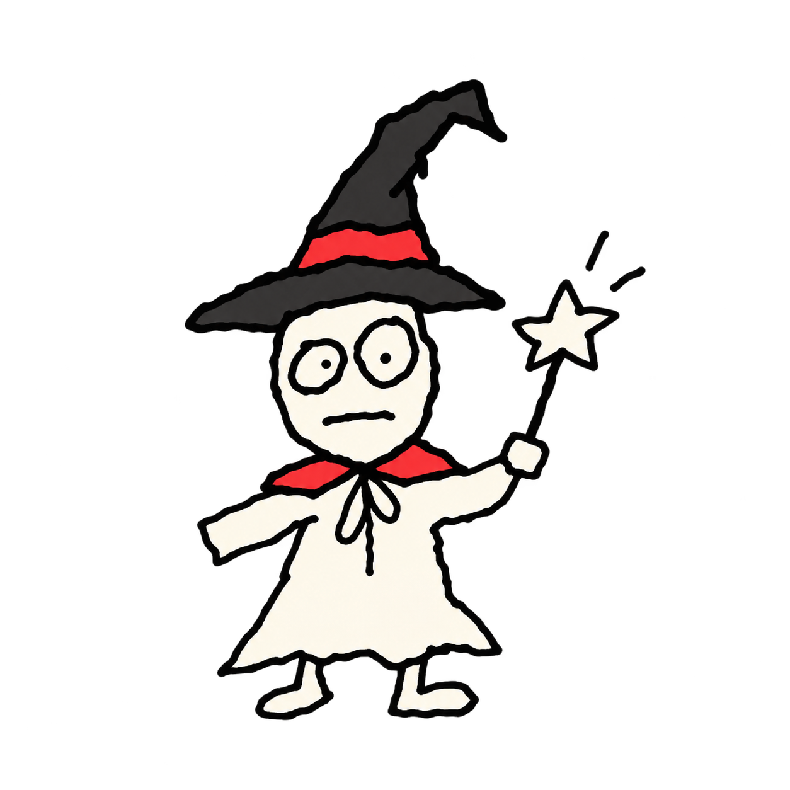
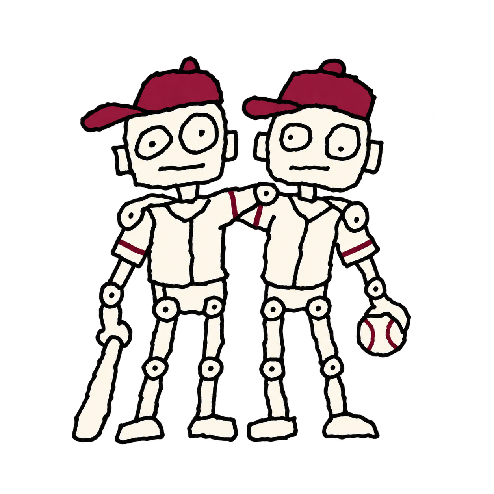
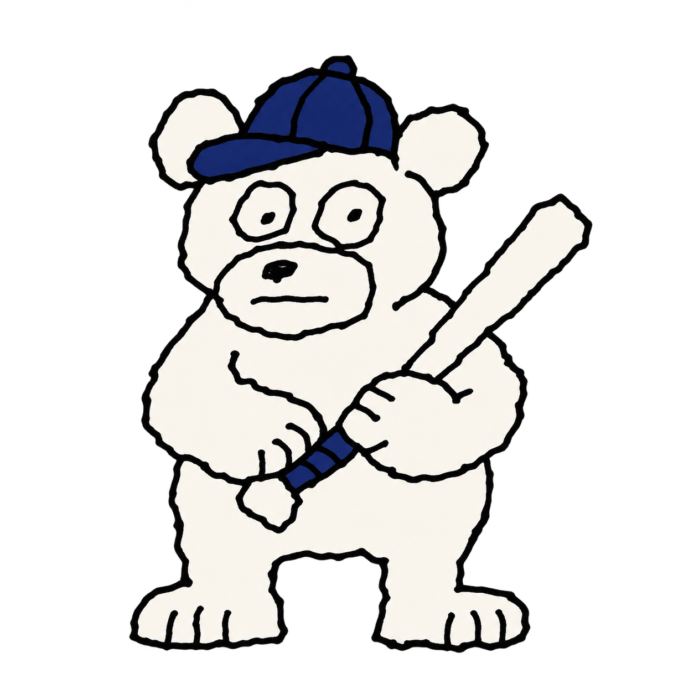
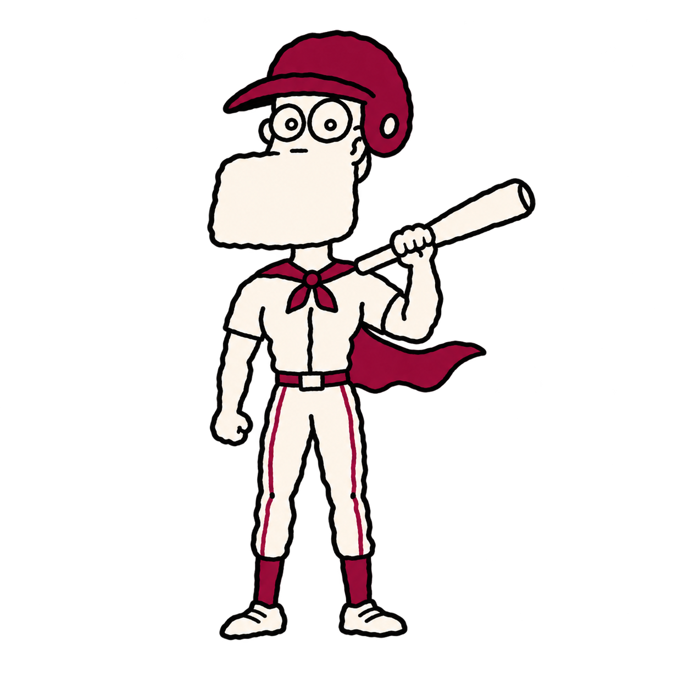

# 팀 시그니처 캐릭터 · 낙서풍 v1

2026-11-06. 사용자 지정 캐릭터를 마우스 낙서풍으로 제작한 투명 PNG 10종. 내장 image_gen으로 생성했으며 전체 프롬프트는 [manifest.json](manifest.json)에 보관한다. [전체 미리보기](preview.html)는 로컬 브라우저에서 연다.

| 팀 | 파일 | 팀 | 파일 |
|---|---|---|---|
| 삼성 · 사자 |  | KIA · 호랑이 |  |
| 롯데 · 갈매기 |  | 한화 · 독수리 |  |
| NC · 공룡 |  | SSG · 카네코르소 |  |
| KT · 마법사 |  | LG · 쌍둥이 야구로봇 |  |
| 두산 · 곰 |  | 키움 · 큰 턱의 영웅 |  |

## 사용

- 2026-11-06 승인된 최종 에셋 10종이다. 키움은 마지막으로 수정한 사람형 턱돌이 이미지 한 장(`wo-doodle-v1.png`)으로 확정했다. 나머지 9종은 최초 낙서풍 결과를 그대로 사용한다.
- 최종 파일의 SHA-256은 `SHA256SUMS`에 기록한다.
- 원본 알파 채널을 유지한 개별 PNG. resizeMode=contain으로 전체 형태를 유지한다.
- 검은 외곽선이므로 밝은 아이보리 영역에 배치하는 것을 권장한다.
- 현재는 이미지 에셋 제작 단계이며 앱의 시스템 이모지 교체와 새 설치 빌드에는 아직 반영하지 않았다.
- 구단 공식 배포 이미지가 아닌 이 서비스용 생성 이미지다. 색상 포인트 역시 공식 색상값을 보증하지 않는다.
