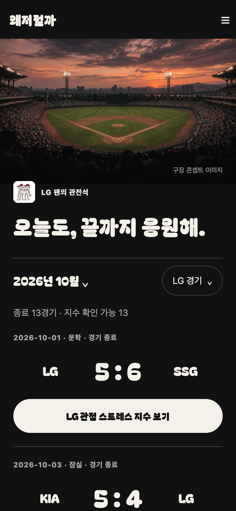
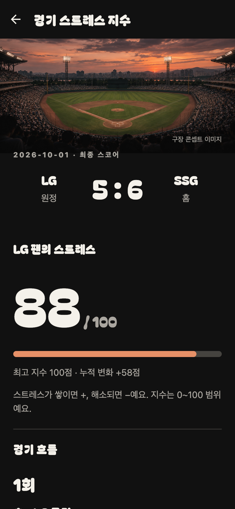

# 디자인 명세

2026-11-06 갱신. **응원팀과 무관한 고정 다크 테마**에 구장 이미지, Bagel Fat One 타이포그래피, 아이보리 알약형 버튼을 적용한다. 팀 선택은 경기 필터·관점·캐릭터만 바꾸며 배경·버튼·모달·선택 색상은 바꾸지 않는다.

## 승인된 방향

위 이미지는 레이아웃과 분위기를 승인한 생성형 콘셉트다. 실제 앱 캡처나 특정 구장의 정확한 재현이 아니다. 현재 제공하는 기능에 맞춰 시즌 경기 목록과 상세 화면에 적용한다. 시안의 샘플 점수·라이브 상태·공유·탭을 실제 기능으로 간주하지 않는다.

## 색상과 컴포넌트

공통 토큰은 `apps/mobile/src/theme.ts`, 버튼·텍스트·구분선은 `ui.tsx`, 구장 이미지는 `StadiumHero.tsx`에서 관리한다. 응원팀 팔레트와 테마를 연결하는 코드는 제거했다.

| 역할 | 색상·규칙 |
|---|---|
| 화면 배경 | 차콜 `#111111` |
| 모달·선택 표면 | `#20201F` |
| 주요 텍스트·CTA | 아이보리 `#F4F1EA` |
| CTA 위 글자 | 차콜 `#111111` |
| 보조 텍스트 | 회색 `#AAA69F` |
| 구분선 | `#45433F` |
| 스트레스 증가 | 주황 `#E69067`, 양수 부호와 설명 병기 |
| 스트레스 회복 | 민트 `#8DCEB4`, 음수 부호와 설명 병기 |

정보 구획은 여백과 얇은 구분선을 사용한다. 버튼은 알약 형태와 최소 높이 50pt를 유지하며 눌림·비활성 상태를 구분한다. 팀 선택과 월 선택은 중립 표면·아이보리 테두리·체크 표시로 구분한다. 팀 캐릭터의 기존 색은 이미지 내부에서만 사용한다.

## 타이포그래피

| 용도 | 서체 |
|---|---|
| 워드마크·화면 제목·소제목 | Bagel Fat One Regular |
| 스코어·스트레스 지수·주요 버튼 | Bagel Fat One Regular |
| 날짜·선수의 사건 설명·보조 문구·오류 | 시스템 고딕 |

Bagel Fat One을 앱에 번들로 포함하고 OFL 라이선스를 보관한다. 긴 제목·팀명·버튼은 줄바꿈을 허용한다. 숫자를 이미지에 넣지 않고 실제 데이터와 텍스트로 렌더링한다.

## 화면

- **응원팀 선택:** 고정 차콜 화면에 팀 캐릭터와 선택 상태를 표시한다. 저장 전 팀을 눌러도 화면 테마는 바뀌지 않는다.
- **시즌 경기:** 구장 이미지, 작은 응원팀 캐릭터·관전석 라벨, 둥근 제목, 연월 선택과 현재 팀 필터, 큰 스코어와 지수 진입 버튼을 표시한다. 다른 팀은 모달에서 고른다. 기본 월은 선택한 팀의 최근 종료 경기 월이며 비시즌 월은 제외한다.
- **경기 상세:** 구장 이미지 아래 실제 원정·홈 최종 점수, 선택 관점의 큰 스트레스 지수·게이지, 이닝별 타임라인을 표시한다. 상대 팀 관점 전환과 새로고침은 하단에 둔다.
- **설정·알림·체험·원시 기록:** 같은 고정 토큰과 타이포를 사용한다. 기존 기능과 라우팅을 유지한다.

## 데이터 상태와 접근성

- 경기 목록을 기다리는 동안 중립색 스켈레톤을 표시한다. 아직 모르는 월이나 임시 0점을 표시하지 않는다.
- 점수와 스트레스 응답은 독립적으로 불러온다. 누락된 점수는 확인 불가, 준비되지 않은 지수는 해당 상태로 표시한다.
- 사건은 이닝 숫자순·초/말로 묶고 같은 그룹 안에서는 원본 순서를 유지한다. 확인되지 않은 선수명은 추정하지 않는다.
- 각 사건의 선수·내용은 왼쪽, 부호가 붙은 증감은 오른쪽에 둔다. 긴 이름은 줄바꿈한다.
- 지수는 경기 기록과 계산 모델로 만든 재미용 값이다. 실제 감정·관람 기록 또는 의학적 지표로 표현하지 않는다.
- 기본 본문·의미 색상의 대비는 배경과 모달 표면 모두 4.5:1 이상으로 검증한다. 게이지에 접근성 이름과 0~100 범위 값을 제공한다.

## 구장 자산

현재는 앱에 번들된 `assets/stadium/dusk-concept.jpg`를 공통으로 사용하며 화면에 **구장 콘셉트 이미지**로 표시한다. 외부 이미지 요청이 없고 특정 구장의 실제 사진이나 경기 당시 모습으로 표시하지 않는다. 생성 도구·프롬프트는 해당 폴더의 README에 기록한다.

실제 구장별 이미지는 후속 범위다. 확보 시 경기의 개최 구장과 확인된 응원석 매핑으로 이미지를 고른다. 홈팀은 항상 1루라고 가정하지 않으며, 매핑이나 사용 권한이 없으면 공통 콘셉트 이미지를 유지한다. 이미지 시점이 바뀌어도 앱 테마는 유지한다.

## 구현 캡처와 검증

최신 구현 캡처는 모바일 크기 **웹 렌더링**이다. 로컬 검증 프록시를 통해 실제 경기 API에 연결하며 생성형 UI 시안이나 네이티브·스토어 제출 스크린샷이 아니다.

| 시즌 경기 | 경기 상세 |
|---|---|
|  |  |

2026-11-06 검증: iOS·Android·웹 번들 export, 타입 검사, 린트, 18개 도메인·대비 테스트 통과. 390px·320px 웹 화면에서 팀 저장·재진입·LG/두산 변경·경기 필터·시즌 월 선택·상세 진입·상대 팀 관점 전환 및 고정 테마를 확인했다. 페이지 JavaScript 오류와 가로 넘침은 없었다. 로컬 웹 주소는 운영 API의 허용 출처가 아니므로 캡처 검증에서만 요청을 프록시했다. 운영 CORS 설정은 변경하지 않았다. 새 네이티브 빌드의 실기기 확인과 스토어용 캡처는 별도다.

## 참고

- [CREME 디자인 레퍼런스](https://mobbin.com/apps/creme-ios-2437b570-6f06-4b2a-a683-834d6a6ee2de): 분위기 참고용이며 자산 복제 대상이 아니다.
- [Bagel Fat One 소스와 OFL](https://github.com/google/fonts/tree/main/ofl/bagelfatone)
