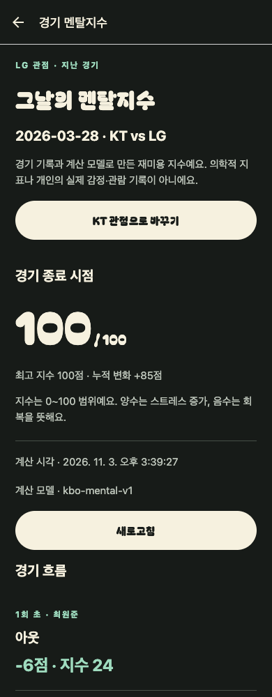

# 모바일 서버 경기 조회

홈의 **서버 경기 기록 조회**에서 서버에 저장된 과거 경기 목록과 상세를 조회한다. 기존 가상 경기 체험과 별도 경로이며 서버 오류를 샘플 경기로 대체하지 않는다.

## 연결

Expo 빌드/개발 환경의 공개 설정 `EXPO_PUBLIC_API_URL`에 API 루트 URL을 지정한다. 토큰·DB URI·비밀값을 넣지 않는다. 환경 변수 변경은 앱 JavaScript 번들을 다시 생성해야 반영된다.

```sh
# 저장소 루트에서 개발 서버 실행 예시
EXPO_PUBLIC_API_URL=https://api.example.com npm start
```

- 네이티브 기기는 해당 API 주소에 실제로 접근할 수 있어야 한다.
- 공개 테스트/출시 환경은 HTTPS를 사용한다. 로컬 HTTP는 OS의 네트워크 정책에 따라 차단될 수 있다.
- Android 에뮬레이터에서 호스트 Mac의 localhost는 `10.0.2.2`, iOS 시뮬레이터는 `127.0.0.1`이다. 실기기의 localhost는 휴대폰 자신이므로 사용할 수 없다.
- 웹에서 확인하려면 API의 CORS에 해당 웹 origin이 허용되어야 한다. CORS 변경은 네이티브 앱 연결의 필수 조건은 아니다.
- 환경 변수가 없으면 설정되지 않았다는 상태를 명시한다. 샘플 데이터로 자동 전환하지 않는다.

## API와 표시 범위

| 화면 | 요청 | 처리 |
|---|---|---|
| `/records` | `GET /v1/games?year=2026&month=9` | 한국 날짜 기본값, 연도·월 선택/조회, 로딩·오류·재시도·빈 목록 |
| `/records/[id]` | `GET /v1/games/{id}` | 점수·경기 날짜·서버 수집 시각·출처, 새로고침·오류·재시도 |

현재 계약은 `source=kbo-public-probe`, `verification=historical-response-only`다. 앱은 응답을 실행 시 검증하고 다른 출처/검증 상태, 잘못된 날짜/점수/타임스탬프, 요청과 불일치하는 ID/날짜를 오류로 처리한다. 계약을 확장하면 서버와 앱을 함께 변경해야 한다.

수집 시각은 서버가 조회한 시각이며 경기 사건 발생 시각이 아니다. 빈 목록은 저장된 기록이 없다는 뜻이며 당일 실제 경기 유무를 단정하지 않는다. HTML 중계 줄 수를 타석/사건 수로 표시하지 않고, 검증되지 않은 자료로 스트레스 점수나 선수별 통계를 생성하지 않는다. 팀명 매핑이 아직 없으므로 서버의 팀 식별자를 그대로 표시한다.

## 검증

`npm test`에 API 계약 테스트가 포함된다: 정상/빈 목록, 날짜 검증, 404/503, 설정 없음, 응답 형식·출처·ID 불일치, 요청 시간 초과·취소. 화면은 나갈 때 요청을 취소하며 이전 요청의 응답이 새 조회 결과를 덮지 않도록 방지한다.

## 남은 출시 작업

실제 운영 API 주소·환경 설정 및 기기 연결 검증, 정규화된 실시간 이벤트 API, 지연 상태·정정 처리, 개인 기록 인증/영속화, 선수 통계, 응원팀 설정, 서버 알림, 확정 디자인은 별도 작업이다. 이 조회 화면을 실제 자동 경기 기록 서비스 구현 완료로 간주하지 않는다. 기존 샘플 Appium 시나리오는 유지되며 서버 조회 화면의 네이티브 E2E 테스트는 추가해야 한다.

## 이번 구현의 디자인 범위

다크 배경, 아이보리 알약형 CTA, 주황 증가·민트 회복, 얇은 구분선, Bagel Fat One 제목·주요 버튼·큰 멘탈 숫자를 공통 컴포넌트에 적용했다. Bagel 원본 TTF와 OFL을 번들로 포함하고 `expo-font`로 로드한다. 본문은 시스템 서체를 유지한다. 구장 히어로·검증된 응원석 시점·팀별 색상 선택은 아직 구현하지 않았다.

2026-11-02 검증: 타입 검사·lint·7개 도메인/API 테스트·iOS/Android/web export 성공. 모바일 크기의 웹 브라우저에서 Bagel 로딩, 홈 → 서버 조회 이동, 설정 미완료 상태·재시도·잘못된 날짜 오류 표시를 확인했다. 이 변경의 새 네이티브 빌드/실기기 검증은 별도로 필요하다.

## 2026 시즌 공통 멘탈지수

`/season`에서 전체 시즌 목록과 팀·연도·월 필터, 수집 범위를 조회한다. `/season/[id]`에서 참가팀 관점을 바꾸며 최종·최고 지수와 사건별 변화를 확인한다. 관전 여부나 로그인 조건은 없다. `incomplete`/`missing`은 점수 대신 사유를 보여주며 다른 팀의 결과나 샘플 점수로 대체하지 않는다. 팀명은 KBO 팀 코드에서 표시명으로 변환한다. [계산·수집 명세](season-mental.md)를 참고한다.

## 2026 시즌 멘탈지수 조회

홈의 `2026 지난 경기 멘탈지수`에서 시즌 경기 목록과 팀 관점별 계산 결과로 이동한다. 이 경로는 기존 과거 원본 조회 `/records`와 별도다. 로그인이나 관람 이력 없이 조회할 수 있으며, 개인이 실제로 느낀 스트레스를 측정한 값으로 표시하지 않는다.

- `GET /v1/seasons/2026/games`: 팀·연도·월 필터와 계산 자료 확보 현황
- `GET /v1/games/{id}/mental?team_id=...`: ready일 때 종료/최고 지수·누적 변화·사건 타임라인
- missing/incomplete는 점수를 표시하지 않는다. parser 진단 코드는 한국어 안내로 대체한다.

2026-11-03 실제 로컬 API+MongoDB 연동 검증: 전체 종료 729경기 목록, LG·2026-03-28 필터, `20260328KTLG0` 경기의 LG/KT 관점 전환을 확인했다. 당시 서버 응답은 LG 종료 100·누적 +85, KT 종료 0·누적 -85, 각 99개 이벤트였다. UI가 이 응답을 정확히 표시하는 것을 확인했으며, 이 검증 자체가 모든 원본 경기나 계산 모델의 정확성을 보증하지 않는다. 앞서 incomplete 상태에서 점수 미표시도 확인했다.



위 캡처는 **390×1000 모바일 크기의 웹 렌더링**이며 iOS/Android 네이티브 캡처가 아니다. fixture나 생성 시안이 아닌 로컬 서버 응답을 사용했다. 새 네이티브 빌드·실기기 검증은 별도다.

앱 날짜 선택은 연도와 월만 제공하며 일자를 직접 입력하거나 선택할 수 없다. 시즌은 `month=1..12`로 조회하고 `전체 월` 선택 시 month를 생략한다. 기존 스냅샷 조회도 연월 단위다. 현재 앱의 제공 연도는 2026년이며, 경기 카드의 실제 경기일 표시는 유지한다. 기존 일자 API는 구버전 호환용으로만 남긴다.
